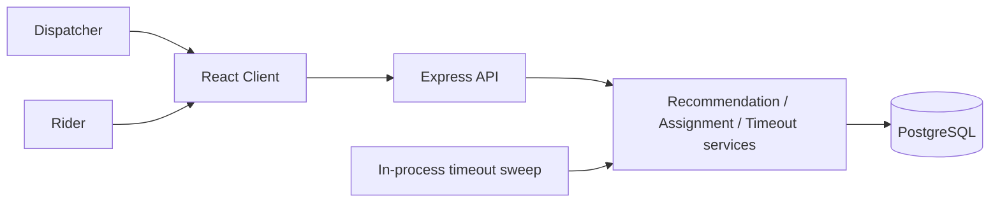

# System design

## Architecture diagram

## Main components

### Client

Role-specific workspaces:

- Dispatcher dashboard: metrics, search/filter, recommendations, overrides, Manual Queue, history
- Rider workspace: accept/reject, pickup, delivery, availability and capacity

Business rules stay in the API. The UI shows loading, empty, and error states for the workspace and for invalid actions.

### Backend

HTTP handlers validate requests and call services. Recommendation ranking, assignment (including capacity reservation and conflict checks), and timeout handling live in dedicated modules so they can be tested without going through every route.

### Data layer

Tables are modeled around the workflow, not screens:

- `jobs` — the delivery order and current status
- `assignments` — one rider confirmation attempt
- `riders` — identity, zones, availability, capacity, workload
- `job_history` — append-only operational events
- `users` — dispatcher and rider accounts

A job can have many assignment attempts. Only one assignment should be `PENDING` at a time.

## Recommendation logic

A rider is eligible when they:

- are `AVAILABLE`
- are currently in the pickup zone
- list the delivery zone in supported zones
- have available capacity for the load
- stay within total capacity after adding current workload

Ranking then prefers higher remaining capacity, lower workload, higher job priority, nearer deadlines, and lower simulated zone-to-zone travel time. The dispatcher can assign a lower-ranked eligible rider if they record an override reason. If nobody is eligible, the job remains unassigned and is placed in the Manual Queue with reason `No eligible rider available`.

## Assignment, capacity, and timeout

Capacity is reserved when the assignment is created, not when the rider accepts. That prevents two jobs from claiming the same remaining capacity during the confirmation window.

| Event | Job status | Assignment | Capacity |
| --- | --- | --- | --- |
| Assign | `AWAITING_CONFIRMATION` | `PENDING` | Reserved |
| Accept | `ACCEPTED` | `ACCEPTED` | Stays reserved |
| Reject | `MANUAL_QUEUE` | `REJECTED` (kept) | Released |
| Timeout | `MANUAL_QUEUE` | `TIMED_OUT` (kept) | Released |
| Deliver / cancel after accept | `DELIVERED` / `CANCELLED` | unchanged | Released |

Default confirmation window is two hours (`ASSIGNMENT_TIMEOUT_MINUTES=2`). Reviewers can lower it and either wait, call `POST /api/jobs/:id/timeout`, or let the in-process sweep expire overdue rows.

## Consistency risks

### Concurrent assignment

Two dispatchers can click assign on the same job. The assign path locks the job row, rejects the request if a pending assignment already exists or the status is no longer assignable, and creates the assignment in the same transaction as the capacity reserve.

### Duplicate submissions

A SHA-256 hash of pickup, delivery, load, priority, and deadline is stored uniquely on the job. Retries return the existing job with `409`.

### Timeout vs confirm

Confirm and timeout both lock the pending assignment. The second caller receives `409` if the assignment is no longer pending.

### Invalid lifecycle

Transitions are validated in one map. A job cannot be marked `DELIVERED` before `PICKED_UP`, and `CANCELLED` / `DELIVERED` jobs cannot continue the happy path.

## Indexes and constraints

- unique `order_reference` and `duplicate_hash` on jobs
- unique rider and user emails / rider references
- indexes on job status, zones, assignment `(job_id, status)`, and history `(job_id, event_timestamp)`

## Scaling notes

This is sized for a small operations team on one Postgres instance. At higher volume:

- move timeout processing to a worker and `FOR UPDATE SKIP LOCKED`
- add a unique partial index on pending assignments per job
- maintain a dashboard read model instead of scanning job statuses
- replace simulated travel times with a real ETA service

## Design trade-off

The implementation favors an understandable single-node workflow over a distributed event bus. Assignment attempts are first-class rows so history, capacity, and timeouts stay consistent without reconstructing the past from the current job status alone.
